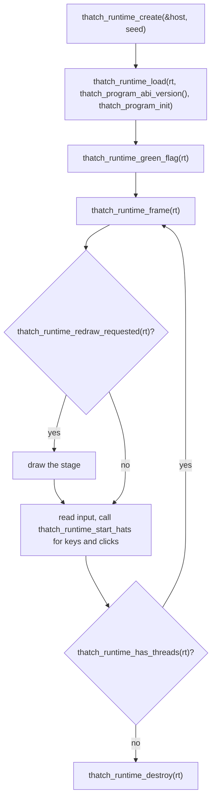

# The C ABI

A compiled program and the runtime it links against meet at a C ABI, declared in the `thatch-abi` crate. The crate is `no_std`, has no dependencies and is the single source of truth: the code generator reads the function list from it, the runtime defines every function on it (a test checks that), and a host written in C or C++ includes the header generated from it, `crates/thatch-abi/include/thatch.h`.

There are two sides to it. Generated code calls the runtime (`RT_FNS`); a host, the program that owns the window and the frame loop, calls the runtime too (`HOST_API`) and is called back through a table of function pointers (`Host`).

The ABI is versioned (`ABI_VERSION`). Every change to a function or a layout bumps it. A program records the version it was compiled for, and the host refuses to run a program built for another one, since a mismatch would otherwise show up as memory corruption.

## What a program exports

`thatch_program_init(runtime)`
: Called once by the host. The program registers its string constants (`thatch_add_const`), its targets (`thatch_add_target`), their variables (`thatch_add_num_var`, `thatch_add_any_var`) and its scripts (`thatch_add_script`, with a hat kind, an argument such as a broadcast name, and the script's function pointer).

`thatch_program_abi_version()`
: Returns the `ABI_VERSION` the program was compiled against, as an `int32_t`. A host calls it before `thatch_program_init`.

`main(argc, argv)`
: Only in executables. Calls `thatch_main(argc, argv, init, abi_version)`, the headless host's entry point, with the init function and the program's ABI version. It returns a nonzero exit status when the versions differ.

A script is `void script(ThreadCtx *ctx)`. A custom block is the same with its parameters after the context: a `double` for a numeric parameter, an `int8_t` for a boolean one, and a `Value *` for a dynamically typed one.

## What a thread sees

```c
struct Value { uint64_t tag; uint64_t bits; };   // tag 0 number, 1 string handle, 2 boolean

struct ThreadCtx {
    double *nums;              // the target's numeric variables
    struct Value *anys;        // the target's dynamically typed variables
    double *stage_nums;        // the stage's
    struct Value *stage_anys;
    const void *const *consts; // string handles of the constant pool
    uint64_t killed;           // nonzero once the thread was stopped
    void *inner;               // private to the runtime
};
```

Generated code reads and writes numeric variables straight through these pointers; everything else goes through a runtime function.

## The runtime functions

All take the C calling convention. Pointers are 64-bit, booleans are `int8_t`. The list in `thatch_abi::RT_FNS` is authoritative; in short:

Strings
: `thatch_num_to_str`, `thatch_str_to_num`, `thatch_str_to_bool`, `thatch_bool_to_str`, `thatch_join`, `thatch_letter_of`, `thatch_length`, `thatch_contains`, and `thatch_temps_clear`, which releases the strings made during the statement.

Dynamically typed values
: `thatch_any_to_num`, `thatch_any_to_str`, `thatch_any_to_bool`, `thatch_any_snapshot` (copies a variable's value for a custom block argument, so the block still sees the old value after it changes the variable), the `thatch_var_set*` family that stores into a variable with the right reference counting, `thatch_var_change`, and `thatch_compare` and `thatch_compare_nums` for `Cast.compare`.

Arithmetic
: `thatch_mod`, `thatch_round`, `thatch_mathop`, `thatch_random`, `thatch_timer`, `thatch_reset_timer`.

Control
: `thatch_yield`, `thatch_wait`, `thatch_say`, `thatch_say_for`, `thatch_broadcast`, `thatch_broadcast_wait`, `thatch_stop_all`, `thatch_stop_others`, `thatch_proc_enter` and `thatch_proc_exit`. After each of these that can yield, generated code checks `ThreadCtx::killed`.

## Writing a host

A host owns the window, the clock and the frame loop. The runtime owns everything Scratch: targets, variables, strings, threads and the scheduler. They meet in `thatch.h`.

The host fills in a `ThatchHost` table and hands it to the runtime:

```c
typedef struct ThatchHost {
    void *data;          /* passed back to every callback */
    ThatchSayFn say;     /* a target said or thought something; empty text clears the bubble */
    ThatchNowFn now_ms;  /* the clock wait and timer read; NULL for the virtual clock */
} ThatchHost;
```

A null callback means the host does not care. Without `now_ms` the runtime uses a virtual clock of one frame per thirtieth of a second, which is what makes the headless host's runs repeatable; a windowed host passes its real clock.

Then it drives the runtime through the `thatch_runtime_*` functions:



`thatch_runtime_load` returns `THATCH_LOAD_WRONG_ABI_VERSION` or `THATCH_LOAD_NO_STAGE` instead of `THATCH_LOAD_OK` when the program cannot run; `thatch_runtime_frame` returns nonzero after an error that `thatch_runtime_last_error` describes. After either, the runtime may only be destroyed. `thatch_runtime_target_count`, `thatch_runtime_target_name` and `thatch_runtime_target_is_stage` describe the program's targets, so the `say` callback can name the sprite. Nothing is thread-safe: one runtime belongs to one thread, and the host may only call into it between frames.

The headless host in `thatch-runtime` is the reference implementation and uses nothing but this API, so every sample run exercises it. A host written in C or C++ such as Scratch Everywhere! implements the same table; what it still lacks is sprite state (position, costume, effects) and the input, pen and sound callbacks, which are the next steps on the [roadmap](roadmap.md). Scratch Everywhere! is LGPL-3.0, so its host lives in a separate repository; nothing from it is part of this one.

The header is generated from `thatch-abi` by `cargo test -p thatch-abi` with `THATCH_UPDATE_HEADER=1` set, and a test fails when it is out of date.
