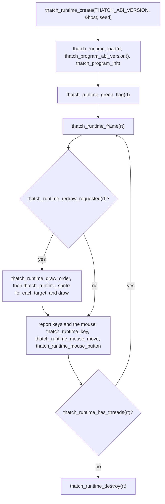

# The C ABI

A compiled program and the runtime it links against meet at a C ABI, declared in the `thatch-abi` crate. The crate is `no_std`, has no dependencies and is the single source of truth: the code generator reads the function list from it, the runtime defines every function on it (a test checks that), and a host written in C or C++ includes the header generated from it, `crates/thatch-abi/include/thatch.h`.

There are two sides to it. Generated code calls the runtime (`RT_FNS`); a host, the program that owns the window and the frame loop, calls the runtime too (`HOST_API`) and is called back through a table of function pointers (`Host`).

The ABI is versioned (`ABI_VERSION`). Every change to a function or a layout bumps it. A program records the version it was compiled for, and the host refuses to run a program built for another one, since a mismatch would otherwise show up as memory corruption.

## What a program exports

`thatch_program_init(runtime)`
: Called once by the host. The program registers its string constants (`thatch_add_const`), its targets (`thatch_add_target`), their costumes by name (`thatch_add_costume`), how each starts out on the stage (`thatch_set_sprite`: position, direction, size, costume, visibility, rotation style, draggability and volume), their variables (`thatch_add_num_var`, `thatch_add_any_var`) and its scripts (`thatch_add_script`, with a hat kind, an argument such as a broadcast name, and the script's function pointer).

`thatch_program_abi_version()`
: Returns the `ABI_VERSION` the program was compiled against, as an `int32_t`. A host calls it before `thatch_program_init`.

`main(argc, argv)`
: Only in executables. Calls `thatch_main(argc, argv, init, abi_version)`, the headless host's entry point, with the init function and the program's ABI version. It returns a nonzero exit status when the versions differ.

A script is `void script(ThreadCtx *ctx)`. A custom block is the same with its parameters after the context: a `double` for a numeric parameter, an `int8_t` for a boolean one, and a `Value *` for a dynamically typed one.

## What a thread sees

```c
struct Value { uint64_t tag; uint64_t bits; };   // tag 0 number, 1 string handle, 2 boolean

struct ThreadCtx {
    double *nums;              // the target's numeric variables
    struct Value *anys;        // the target's dynamically typed variables
    double *stage_nums;        // the stage's
    struct Value *stage_anys;
    const void *const *consts; // string handles of the constant pool
    uint64_t killed;           // nonzero once the thread was stopped
    void *inner;               // private to the runtime
};
```

Generated code reads and writes numeric variables straight through these pointers; everything else goes through a runtime function.

## The runtime functions

All take the C calling convention. Pointers are 64-bit, booleans are `int8_t`. The list in `thatch_abi::RT_FNS` is authoritative; in short:

Strings
: `thatch_num_to_str`, `thatch_str_to_num`, `thatch_str_to_bool`, `thatch_bool_to_str`, `thatch_join`, `thatch_letter_of`, `thatch_length`, `thatch_contains`, and `thatch_temps_clear`, which releases the strings made during the statement.

Dynamically typed values
: `thatch_any_to_num`, `thatch_any_to_str`, `thatch_any_to_bool`, `thatch_any_snapshot` (copies a variable's value for a custom block argument, so the block still sees the old value after it changes the variable), the `thatch_var_set*` family that stores into a variable with the right reference counting, `thatch_var_change`, and `thatch_compare` and `thatch_compare_nums` for `Cast.compare`.

Arithmetic
: `thatch_mod`, `thatch_round`, `thatch_mathop`, `thatch_random`, `thatch_timer`, `thatch_reset_timer`.

Control
: `thatch_yield`, `thatch_wait`, `thatch_say`, `thatch_say_for`, `thatch_broadcast`, `thatch_broadcast_wait`, `thatch_stop_all`, `thatch_stop_others`, `thatch_proc_enter` and `thatch_proc_exit`. After each of these that can yield, generated code checks `ThreadCtx::killed`.

Motion
: `thatch_move_steps`, `thatch_go_to_xy`, `thatch_go_to` (a sprite name, `_mouse_` or `_random_`), `thatch_set_x`, `thatch_set_y`, `thatch_change_x`, `thatch_change_y`, `thatch_turn`, `thatch_point_in_direction`, `thatch_point_towards`, `thatch_glide` and `thatch_glide_to` (which yield until the time is up), `thatch_bounce`, `thatch_set_rotation_style`, and the reporters `thatch_sprite_x`, `thatch_sprite_y` and `thatch_sprite_direction`.

Looks
: `thatch_set_visible`, `thatch_switch_costume` and `thatch_switch_backdrop` (with a dynamically typed value: a number is a costume number, a string a name first), `thatch_next_costume`, `thatch_next_backdrop`, `thatch_set_size`, `thatch_change_size`, `thatch_set_effect`, `thatch_change_effect`, `thatch_clear_effects`, `thatch_go_to_layer`, `thatch_go_layers`, and the reporters `thatch_sprite_size`, `thatch_costume_number`, `thatch_costume_name` and `thatch_property_of`, which writes the `property of object` value into a slot the caller owns.

Input
: `thatch_mouse_x`, `thatch_mouse_y`, `thatch_mouse_down` and `thatch_key_pressed`, which read what the host last reported.

## Hats

A script's hat is one of the `THATCH_HAT_*` kinds with an argument: the green flag, a broadcast (the message name), a key (the key name as the `when key pressed` menu writes it, or `any`), `when this sprite clicked` and `when stage clicked`. Broadcast and key names match without regard to case. Starting a hat restarts a thread of the same script that is still running, except for key hats, which leave it alone and start nothing, as scratch-vm's `restartExistingThreads` rule has it. Both click hats start on the clicked target only, whichever of the two is on it, so a `when stage clicked` hat on a sprite fires when that sprite is clicked.

## Writing a host

A host owns the window, the clock and the frame loop. The runtime owns everything Scratch: targets, variables, strings, threads, the scheduler, and the state of every sprite: position, direction, size, costume, visibility, graphic effects and layer order. The host draws what the runtime describes. They meet in `thatch.h`.

The host fills in a `ThatchHost` table and hands it to the runtime:

```c
typedef struct ThatchHost {
    void *data;                           /* passed back to every callback */
    ThatchSayFn say;                      /* a target said or thought something; empty text clears the bubble */
    ThatchNowFn now_ms;                   /* the clock wait and timer read; NULL for the virtual clock */
    ThatchSpriteChangedFn sprite_changed; /* a target looks different now */
    ThatchMeasureFn measure;              /* how big a sprite is drawn, for fencing, bouncing and size limits */
} ThatchHost;
```

Zero the struct first, so that callbacks added in later versions are null. A null callback means the host does not care. Without `now_ms` the runtime uses a virtual clock of one frame per thirtieth of a second, which is what makes the headless host's runs repeatable; a windowed host passes its real clock.

The two sprite callbacks decide how much of scratch-vm's renderer behavior the runtime reproduces, because scratch-vm itself behaves differently with and without one:

- `sprite_changed` says the host draws. The runtime calls it whenever a target's position, direction, size, costume, visibility, effects or layer changes, and, as scratch-vm does with a renderer, a change to a visible sprite also requests a redraw, which ends the frame early so that `move 10 steps` in a `forever` loop moves once per frame. Every change, visible or not (hiding a sprite or moving it a layer, for one), makes `thatch_runtime_redraw_requested` true after the frame, so a host that draws only then still shows it. Without the callback, motion requests no redraw, which is what the headless host wants, since the samples are checked against scratch-vm without a renderer.
- `measure` answers `THATCH_MEASURE_BOUNDS` (the tight bounds of the sprite as drawn), `THATCH_MEASURE_BOX` (its axis-aligned bounding box) and `THATCH_MEASURE_COSTUME_SIZE` (the costume's unscaled width and height), all in Scratch coordinates, with the state the sprite has at the time of the call. With it, the runtime fences every move so that at least 15 pixels of the sprite stay on the stage, makes `if on edge, bounce` work and clamps sizes between 5 pixels and one and a half stages, exactly as scratch-render does. Without it, nothing is fenced, bounce does nothing and `set size` stores the number as given.

Every callback may read the runtime back through the `thatch_runtime_*` functions, since the runtime holds no reference to itself while a callback runs: the headless host asks for the target's name in `say`, and `measure` usually asks `thatch_runtime_sprite` where the sprite is. `say`, `sprite_changed` and `measure` receive the runtime for that, and a host that wants it in `now_ms` can keep it in `data`. A callback must not change the runtime: no `thatch_runtime_frame`, load, stop, green flag or input from inside one, and no destroying it. The runtime makes no callbacks while it is destroyed.

Then it drives the runtime through the `thatch_runtime_*` functions:



To draw, a host asks `thatch_runtime_draw_order` for the targets back to front (the stage first) and `thatch_runtime_sprite` for each one's `ThatchSprite`: position, direction and rotation style, size in percent, costume index (into the costumes the program registered, whose names `thatch_runtime_costume_count` and `thatch_runtime_costume_name` give back), visibility and the seven graphic effects in Scratch's order. The runtime keeps the direction as Scratch shows it, from -179 to 180 with 90 pointing right; the host applies the rotation style when it draws, as scratch-vm's renderer does.

<<<<<<< HEAD
`thatch_runtime_create` takes the ABI version the host was compiled with and returns null for any other, since a host built against another header passes a `ThatchHost` of another size. `thatch_runtime_load` returns `THATCH_LOAD_WRONG_ABI_VERSION` or `THATCH_LOAD_NO_STAGE` instead of `THATCH_LOAD_OK` when the program cannot run, and leaves the runtime as empty as it was created. A runtime holds one program, so a second load returns `THATCH_LOAD_ALREADY_LOADED` and changes nothing. `thatch_runtime_frame` returns nonzero after an error that `thatch_runtime_last_error` describes, after which the runtime may only be destroyed. `thatch_runtime_target_count`, `thatch_runtime_target_name` and `thatch_runtime_target_is_stage` describe the program's targets, so the `say` callback can name the sprite. A callback may call these and the other `thatch_runtime_*` functions that only read. Nothing is thread-safe: one runtime belongs to one thread, and the host may only call into it between frames and from its callbacks.

`thatch_runtime_redraw_requested` tells the host when to draw: after a frame in which something changed what the stage shows or asked for a redraw, after the host itself changed something between frames (`thatch_runtime_stop_all` clearing bubbles, for one), and once after loading. The scheduler keeps its own flag, cleared at the start of every frame, which ends a frame early as scratch-vm's redraw request does.

`thatch_runtime_green_flag` does what clicking the green flag does: it stops every script and clears every bubble first, then resets the timer and starts the green flag scripts. `thatch_runtime_has_threads` counts only scripts that can still run, not ones a stop has killed but the next frame has yet to finish.

### Input

The host reports what the player does, between frames, and the runtime does what scratch-vm's keyboard and mouse devices do with it:

- `thatch_runtime_key(rt, key, len, down)` for a key going down or up. The key is named as a browser's `KeyboardEvent.key` names it (`" "`, `"a"`, `"ArrowLeft"`, `"Enter"`); Scratch's own names (`space`, `left arrow`) work too. Modifier keys and anything else longer than one character are ignored, as in Scratch. A key going down starts the `when key pressed` hats for that key and for `any`.
- `thatch_runtime_mouse_move(rt, x, y)` with the pointer in Scratch coordinates (x from -240 to 240, y from -180 to 180, y up). The runtime rounds and clamps it.
- `thatch_runtime_mouse_button(rt, down, target)` for the button going down or up over `target`: the frontmost target under the pointer as the host sees it, the stage when no sprite is there, or -1 outside the stage. Only the host knows which sprite is under the pointer, since only it knows what it drew. A target that is not draggable is clicked as the button goes down; a draggable one (`thatch_runtime_target_draggable`) as it comes up, so that dragging it does not click it. Dragging itself is not implemented yet.

The sensing blocks `mouse x`, `mouse y`, `mouse down?` and `key pressed?` read this state. A headless host has no input of its own; the one in `thatch-runtime` takes an input script instead (`--input`, see [getting started](getting-started.md)), which the oracle also understands, so the `input` sample checks keys, clicks and the hats they start against scratch-vm.

The headless host in `thatch-runtime` is the reference implementation and uses nothing but this API, so every sample run exercises it; `crates/thatch-cli/tests/host_api.rs` plays a host that draws and checks the fencing, the clamping and the click rules. A host written in C or C++ such as Scratch Everywhere! implements the same table; what it still lacks is pen and sound, which are the next steps on the [roadmap](roadmap.md). Scratch Everywhere! is LGPL-3.0, so its host lives in a separate repository; nothing from it is part of this one.

The header is generated from `thatch-abi` by `cargo test -p thatch-abi` with `THATCH_UPDATE_HEADER=1` set, and a test fails when it is out of date.
