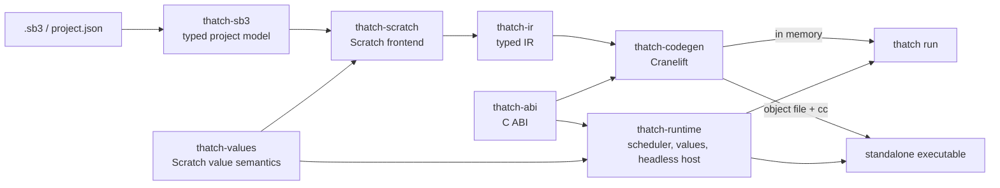

# Architecture

Thatch is a pipeline of small crates. A project goes in one end as JSON and comes out the other as machine code; the runtime it links against is a separate crate that knows nothing about compiling.

## The crates

`thatch-sb3`
: Reads an `.sb3` archive or a `project.json` into a typed model with serde. Everything it does not interpret stays in `extra` maps and raw input arrays, so the model can grow without losing data.

`thatch-values`
: The rules of Scratch values: how a string becomes a number (`Number("0x10")` is 16), how a number becomes a string (`1e21` is `1e+21`), how two values compare, how `say` formats a number. Both the compiler (to fold constants) and the runtime use it, so they cannot disagree. See the crate documentation for the one known difference from JavaScript strings.

`thatch-scratch`
: The Scratch frontend. It walks each target's scripts and custom blocks and lowers them to the IR, inserting explicit casts and yields. It runs to a fixed point over variable and parameter types: every variable whose initial value is a number starts out numeric and is demoted to dynamically typed when some block stores a string or boolean in it; custom block parameters are typed the same way from their call sites. The pass where nothing changes produces the program.

`thatch-ir`
: The [intermediate representation](ir.md). Language-neutral and backend-neutral.

`thatch-abi`
: The [C ABI](abi.md): the `Value` and `ThreadCtx` layouts, the list of runtime functions with their signatures, and the hat kinds. It is `no_std` and has no dependencies, so any host can use it.

`thatch-codegen`
: Lowers the IR to Cranelift IR and from there to machine code, either into memory (for `thatch run`) or into an object file with a C `main` (for `thatch build`). Numbers are `f64` registers, booleans `i8`, strings handles, and dynamically typed values pointers to 16-byte slots.

`thatch-runtime`
: Everything a running program needs that is not its own code: the targets and their variables, strings, the thread scheduler and the headless host. Built as both an rlib (for `thatch run`, which links it into the compiler) and a staticlib (`libthatch_runtime.a`, for executables).

`thatch-cli`
: The `thatch` command.

## Threads

Scratch scripts are cooperative threads: a script runs until the end of a loop iteration, a wait, or something else that yields, then the next script runs, and a frame ends when every active script has yielded, a redraw was requested, or 75 percent of the frame time is used. Thatch keeps that model exactly, with each thread on its own stack (a stackful coroutine from the `corosensei` crate). Generated code is therefore ordinary code: a loop ends with a call to `thatch_yield`, which switches to the next thread and returns when this one is picked again. A custom block is a native call, and can yield from any depth, so recursion costs what a native recursive call costs.

The scheduler steps threads in passes, in list order, the way scratch-vm's sequencer does, including the rules that decide order between threads: new threads start front to back across sprites, a broadcast restarts a running script in place, a recursive call in a script that is not in warp mode yields before running the body, and "run without screen refresh" turns loop yields off until the 500 ms limit.

A thread is never torn down from outside while it is suspended, since that would mean unwinding through generated frames. A stopped thread is marked killed and resumed once more: every yield point checks the flag and returns, so the thread finishes on its own.

## Values and strings

Static types do most of the work. A variable that only ever holds numbers is an `f64` in an array that generated code reads and writes directly; a comparison of two numbers is a compare instruction (with a slow path for NaN, which Scratch compares as the string "nan"). Only values whose type cannot be known at compile time go through the runtime as 16-byte `Value`s.

Strings are immutable and reference counted. Generated code holds them as handles that a runtime call produced; those handles belong to the thread's temporaries and are released at the end of the statement that made them, except across a custom block call, where the callee's parameters may point at them. A variable holding a string keeps its own reference.

## Hosts

A host is the program that owns the window, the clock and the frame loop. It creates a runtime with a table of callbacks (`say`, `now_ms`), loads the compiled program into it and steps frames through the `thatch_runtime_*` functions in the C header; see [the ABI](abi.md#writing-a-host). The runtime owns everything Scratch and calls the host back for what it cannot do itself.

The headless host built into the runtime is the first implementation. It prints every non-empty `say` and `think` as `Name says: text`, formatted the way scratch-vm's bubbles format numbers, and passes no clock, so the runtime's virtual clock of one thirtieth of a second per frame makes each run repeatable. It stops when no script is left or when the frame limit is reached. The tests and the samples rely on it, and since it goes through the same C API a host in C would, they test that API too.
