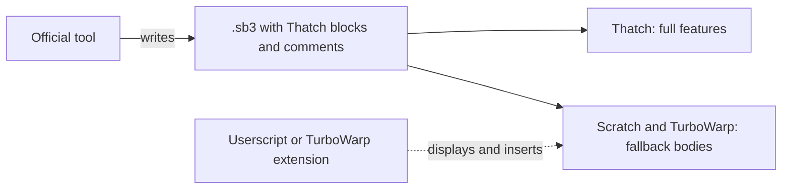

# Language features

!!! note "Draft"
    This page is a design draft for the superset. None of it is implemented yet, and the open questions at the end have to be answered before any of it is.

The superset adds features that vanilla Scratch does not have: FFI into the host, compile-time macros, custom blocks with return values and static type annotations. A project that uses them must still be a valid `.sb3`: the Scratch editor and TurboWarp load it, and they run it in a way its author chose, not by accident.

## The rule: the blocks stay correct

Superset data never changes what a project's blocks mean. Thatch can use it to compile a project faster, or to call something vanilla Scratch has no block for, but whatever Scratch or TurboWarp runs is a fallback the author wrote on purpose. A project that loads in Scratch and quietly behaves differently there is worse than one that refuses to load.

That gives two kinds of superset data:

- **Code**: something that runs at one point in a script, such as an FFI call or a macro call. It is stored as a custom block (see below), and the body of that block's definition is the fallback.
- **Annotations**: information about code that already exists, such as a type, "this custom block returns a value" or "this custom block is pure". It is stored in a comment attached to that code. The blocks run correctly without it, and Thatch uses it to go faster.

## Code: Thatch custom blocks

An FFI call or a macro call is a call to a custom block whose `proccode` starts with a reserved, versioned prefix:

```text
thatch:v1 ffi %s %s %s
thatch:v1 macro %s %s
```

The first argument is the name of the FFI function or macro, plus any static data it needs. The other arguments are ordinary Scratch inputs, so they can hold any reporter, and Thatch lowers and type-checks them like any other input. A string of DSL should never stand in for an argument, since it cannot refer to the script's variables safely, and an edit in the Scratch editor would not update it.

Thatch recognizes these blocks by their `proccode` and ignores the body of their definition, lowering each call to its own IR instead. A user's own block with a similar name (say, "ThatchExp") is just a custom block.

### The fallback is the definition's body

Every sprite that calls a Thatch block has a `define` for it, as Scratch requires. Its body is what Scratch and TurboWarp run:

- **FFI**: nothing, a `say [needs Thatch]`, or an approximation in plain blocks (an FFI call that sets the pitch of a sound could fall back to the sound effect blocks).
- **Macros**: the macro written out in plain blocks. The project then works everywhere, just slower outside Thatch, and Thatch replaces each call with the macro's compile-time expansion.

Calling a custom block costs one procedure call in scratch-vm. `stepToProcedure` yields only when the call is recursive, or when it runs in warp mode after the warp timer has run out, so a call that does no work does not change frame timing outside warp mode. Thatch must model that warp timer check at these calls just as it does for other procedure calls.

### Return values

Custom blocks are stack blocks in vanilla Scratch, so an FFI call cannot be saved as a reporter. A call that returns a value takes the name of a variable or list as an argument and writes the result there. An editor can draw such a call as a reporter (see [Editing](#editing)), but the saved project always uses this form.

### Definitions in every sprite

Custom blocks belong to one sprite, so each sprite, and the stage, needs its own `define` for every Thatch block it uses. The official tool and the editor helpers create these definitions and hide them. In the vanilla editor they show up like any other definition.

## Annotations: attached comments

An annotation is a block comment whose text starts with the line `// _thatch_`, in the style of TurboWarp's `// _twconfig_` comment. In `project.json`, a comment attached to a block names that block in its `blockId` field, so the comment needs no markers to find its code:

- A comment on a hat block covers that script.
- A comment on `procedures_definition` covers that custom block. This is where return values, parameter types and purity go.
- A comment on any other block covers that block.

To annotate part of a script, wrap it in `if <not <>>` and attach the comment to the `if`. An empty boolean input is false, so the condition is always true, and `if` adds no yield. (`repeat (1)` would add one at the end of the loop outside warp mode.)

Each annotation records a format version and a hash of the blocks it covers. When someone edits those blocks in the Scratch editor, the hash no longer matches, so Thatch warns and compiles the blocks without the annotation. The same rule covers macro expansions edited by hand (see [the roadmap](roadmap.md#then-beyond-scratch)).

Thatch ignores comments without the `// _thatch_` line. A comment that has the line but is malformed is a reported error, never a crash.

## Where the source lives

People do not write the superset data by hand. The official tool generates it from its own source files, so those files are the real program and the `.sb3` is the build output, much as with goboscript. Editing the `.sb3` in Scratch is still safe because of the fallbacks and the hash check, but the tool's source is what the author keeps.

## Editing



The saved form is plain custom blocks and comments, so any editor can open a project. Nicer editing comes from a helper that changes how the editor shows them, in order of effort:

1. **A userscript or editor addon** that draws `thatch:` calls as their own blocks, hides their definitions and shows calls that return a value as reporters. It needs no fork and survives editor updates best.
2. **A TurboWarp extension** that adds the Thatch blocks to the palette, and stubs that let TurboWarp run them. Its blocks must still be saved as `thatch:` custom block calls, not under the extension's own opcodes: vanilla scratch-vm refuses to load a project that names an extension it does not know, so saved extension opcodes would break loading in Scratch.
3. **A fork of the editor**, only if the first two cannot do something needed, such as new kinds of input.

Any of these lives outside the Thatch repository, or fenced off like the projects under `hosts/`. TurboWarp's editor and addons are GPL-3.0, so a fork of them, or code taken from them, is GPL-3.0 too and must never flow into Thatch. Upstream scratch-gui (BSD-3-Clause) and scratch-blocks (Apache-2.0) do not have that problem.

## Trust

A project comes from whoever shared it. FFI calls into the host, so the host and `thatch` flags decide which FFI functions a project may call, just as they cap what a [settings comment](roadmap.md#then-close-the-compatibility-gaps) may raise. A call the host does not allow is a reported error at build time, or a refused call at run time with the fallback body run instead.

## Open questions

- Do extra mutation attributes survive? The sb3 serializer copies a block's mutation as it is, but scratch-blocks may rebuild the mutation when someone edits the block, which would drop anything it does not know. Until that is tested, superset data lives only in the `proccode`, inputs and comments.
- Do attached comments survive duplicating a script, the backpack and dragging a script to another sprite? Wherever they get lost, the hash check is what keeps the project correct, but the annotation is lost too.
- How should a call with a variable number of arguments work? A `proccode` has a fixed number of arguments, so it needs either one definition per argument count or a list argument.
- How does the IR represent an FFI call? It needs a runtime call through the C ABI that names a host function, and the ABI needs a way for a host to list the functions it offers.
