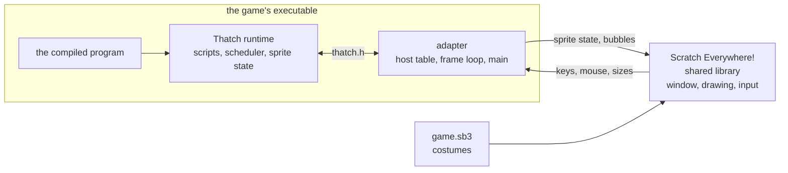

# The Scratch Everywhere! host

The headless host prints what sprites say. To see them, a game needs a host with a window, and the first one is built on [Scratch Everywhere!](https://github.com/ScratchEverywhere/ScratchEverywhere), the C++ Scratch player. It lives in `hosts/scratch-everywhere/`, outside the Cargo workspace.

Scratch Everywhere! is a complete Scratch runtime of its own. Thatch uses the half it is good at and replaces the other half:



The Thatch runtime runs every script and owns all Scratch state, as with any host: Thatch keeps its own scheduler, which follows scratch-vm more closely than Scratch Everywhere!'s (the order hats start in within a sprite, restarted threads, `wait` in warp mode, the recursion rule). Scratch Everywhere! loads the project file for its costumes, opens the window, draws the sprites and their speech bubbles and reads the keyboard and the mouse. It runs no scripts.

## What works

- Sprites and the backdrop are drawn from the project's costumes, with position, direction and rotation style, size, costume, visibility, layer order, and the ghost and brightness effects.
- `say` and `think` bubbles.
- The keyboard and the mouse: `key pressed?`, `mouse x`, `mouse y`, `mouse down?`, and the `when key pressed`, `when this sprite clicked` and `when stage clicked` hats. A click goes to the frontmost sprite under the pointer whose costume is not transparent there.
- Sprites are fenced to the stage, `if on edge, bounce` works and sizes are limited, since the host can measure what it draws.
- The stage size and the frame rate come from the Thatch runtime, so the window and the runtime agree.

Not yet, in the order of the [roadmap](roadmap.md): variable monitors, pen, the sensing blocks that need a stage (touching, touching color, distance to, ask), dragging sprites and sound. The other graphic effects (color, fisheye, whirl, pixelate, mosaic) are passed on but Scratch Everywhere!'s SDL renderer does not draw them. Linux and macOS are supported; Windows is not yet.

## Building the host

You need CMake 3.21 or newer, a C++17 compiler, git and SDL2 (`libsdl2-dev` on Debian and Ubuntu, `brew install sdl2` on macOS).

```sh
git submodule update --init hosts/scratch-everywhere/ScratchEverywhere
cargo build --workspace
cmake -S hosts/scratch-everywhere -B hosts/scratch-everywhere/build -DCMAKE_BUILD_TYPE=Release
cmake --build hosts/scratch-everywhere/build
ctest --test-dir hosts/scratch-everywhere/build --output-on-failure
```

The first configure downloads the libraries Scratch Everywhere! is built from. The build leaves the shared library `libscratch-everywhere` and the adapter `libthatch_host_scratch_everywhere.a` in `hosts/scratch-everywhere/build/lib/`.

The test builds a small game and runs it for two seconds without a window: it plays a key press and two clicks from a script and compares the bubbles with what scratch-vm shows for the same project with a renderer. To watch that game in a window:

```sh
hosts/scratch-everywhere/build/test/game hosts/scratch-everywhere/build/test/game.sb3
```

## Building a game

A game for this host is four things linked together: the object file of the compiled program without `main`, the adapter, the Thatch runtime and the shared library.

```sh
thatch build game.sb3 --object --no-main -o game.o
c++ -o game game.o \
    hosts/scratch-everywhere/build/lib/libthatch_host_scratch_everywhere.a \
    target/debug/libthatch_runtime.a \
    -Lhosts/scratch-everywhere/build/lib -lscratch-everywhere \
    -Wl,-rpath,hosts/scratch-everywhere/build/lib
./game game.sb3
```

On Linux add the libraries the runtime needs from the system: `-lgcc_s -lutil -lrt -lpthread -lm -ldl -lc`; on macOS, `-liconv`. `thatch build --host scratch-everywhere` will do all of this in one step; it is the next item on the roadmap.

The game takes the project file as its argument, since the costumes are read from it at run time. Without an argument it looks for a file named like the executable with `.sb3` added. `--frames N` stops after N frames, `--seed N` seeds `pick random`, `--print-bubbles` also prints every bubble as the headless host does, and `--input FILE` plays a script of key and mouse events in the format of `thatch run --input` on top of the real keyboard and mouse.

## How it fits together

The patch
: Scratch Everywhere! starts every script through two functions, `BlockExecutor::startThread` and `BytecodeExecutor::startThread`. `patches/host-hooks.patch` adds a hook to them: once a host has set it, neither function starts a thread, and the hat block goes to the host instead. That is the whole change to the library's code. The same patch lets a desktop build leave out DECtalk, the speech synthesizer, whose license is unclear. The build applies the patch to a copy of the pinned submodule, so the submodule stays as upstream published it.

The adapter
: `adapter/thatch_host.cpp` implements the [host table](abi.md#writing-a-host) on top of the library and runs the frame loop. Each frame it lets the library poll its input, reports the keys and the mouse to the Thatch runtime, runs a frame of scripts, copies the state of every sprite that changed into the library's own sprites, and has the library draw. `say` goes to the library's speech bubbles, and `measure` answers from the library's costume boxes.

Input
: The adapter reports the raw keys and clicks, and the Thatch runtime starts the hats by scratch-vm's rules, so a `when key pressed` script behaves here as in the headless host. The hats the library finds itself are handed to the hook and dropped. The library polls the keyboard instead of receiving key events, so the adapter repeats a held key as a keyboard would: after half a second, once a frame.

The stage
: The adapter sets the library's stage size and frame rate from `thatch_runtime_stage_width`, `thatch_runtime_stage_height` and `thatch_runtime_frame_rate`, and resizes the window if the stage is not Scratch's 480 by 360.

Measuring is where this host is less exact than scratch-vm's renderer: the library knows a costume's box but does not rotate it, so a turned sprite is fenced and bounced by the box of the upright costume.

## Licenses

Scratch Everywhere! is licensed under the GNU Lesser General Public License, version 3. Thatch keeps everything that touches it in `hosts/scratch-everywhere/`, and nothing outside that directory depends on anything inside it; `tools/check-hosts.sh`, which CI runs, checks that. In the directory, the submodule and the patch are LGPL; the adapter only calls the library, so it has Thatch's license, like the rest. `hosts/scratch-everywhere/LICENSE` lists which file has which.

Your game's own code stays yours, under any license you like: the LGPL makes no demands on a program that merely uses the library. It does make demands on how you ship the library with it. In short, a game built with this host has to:

- ship the library as the shared library it is, so that whoever has the game can replace it with a build of their own (this is why the host does not link it statically);
- say prominently that the game uses Scratch Everywhere! and that the library is covered by the LGPL, and include the texts of the LGPL and of the GPL, version 3 both;
- offer the source code of the library as it was built: the pinned commit of Scratch Everywhere! and `patches/host-hooks.patch`;
- not forbid changing the library, or reverse engineering the game to debug such changes, in the game's own license terms.

These come on top of the [notices of the Thatch runtime](getting-started.md#licenses-of-a-built-executable). The libraries Scratch Everywhere! is itself built from (SDL2, lunasvg, nlohmann/json and others) have notices of their own, which belong with the game as well. This page is a summary to get you started, not legal advice; the license texts are what counts.
