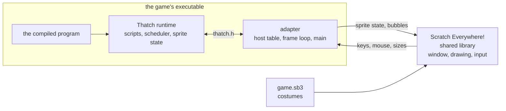

# The Scratch Everywhere! host

The headless host prints what sprites say. To see them, a game needs a host with a window, and the first one is built on [Scratch Everywhere!](https://github.com/ScratchEverywhere/ScratchEverywhere), the C++ Scratch player. It lives in `hosts/scratch-everywhere/`, outside the Cargo workspace.

Scratch Everywhere! is a complete Scratch runtime of its own. Thatch uses the half it is good at and replaces the other half:



The Thatch runtime runs every script and owns all Scratch state, as with any host: Thatch keeps its own scheduler, which follows scratch-vm more closely than Scratch Everywhere!'s (the order hats start in within a sprite, restarted threads, `wait` in warp mode, the recursion rule). Scratch Everywhere! loads the project file for its costumes, opens the window, draws the sprites and their speech bubbles and reads the keyboard and the mouse. It runs no scripts.

## What works

- Sprites and the backdrop are drawn from the project's costumes, with position, direction and rotation style, size, costume, visibility, layer order, and the ghost and brightness effects.
- `say` and `think` bubbles.
- The keyboard and the mouse: `key pressed?`, `mouse x`, `mouse y`, `mouse down?`, and the `when key pressed`, `when this sprite clicked` and `when stage clicked` hats. A click goes to the frontmost sprite under the pointer whose costume is not transparent there.
- Sprites are fenced to the stage, `if on edge, bounce` works and sizes are limited, since the host can measure what it draws.
- The stage size and the frame rate come from the Thatch runtime, so the window and the runtime agree.

Not yet, in the order of the [roadmap](roadmap.md): variable monitors, pen, the sensing blocks that need a stage (touching, touching color, distance to, ask), dragging sprites and sound. The other graphic effects (color, fisheye, whirl, pixelate, mosaic) are passed on but Scratch Everywhere!'s SDL renderer does not draw them. Linux and macOS are supported; Windows is not yet.

## Building the host

You need CMake 3.21 or newer, a C++17 compiler, git and SDL2 (`libsdl2-dev` on Debian and Ubuntu, `brew install sdl2` on macOS).

```sh
git submodule update --init hosts/scratch-everywhere/ScratchEverywhere
cargo build --workspace
cmake -S hosts/scratch-everywhere -B hosts/scratch-everywhere/build -DCMAKE_BUILD_TYPE=Release
cmake --build hosts/scratch-everywhere/build
ctest --test-dir hosts/scratch-everywhere/build --output-on-failure
cmake --install hosts/scratch-everywhere/build
```

The first configure downloads the libraries Scratch Everywhere! is built from. The build leaves the shared library `libscratch-everywhere`, the adapter `libthatch_host_scratch_everywhere.a`, the host's license texts and its description for `thatch build` in `hosts/scratch-everywhere/build/lib/`. A `thatch` built in the same checkout finds them there.

The install step copies them into Thatch's data directory, where every `thatch` looks, including one installed with `cargo install`. It also installs the `libthatch_runtime.a` the host was built and tested with, since `cargo install` installs only the `thatch` executable. The data directory is `~/Library/Application Support/thatch` on macOS and `$XDG_DATA_HOME/thatch` (by default `~/.local/share/thatch`) elsewhere; `THATCH_HOME` moves it, for `thatch` and for the install step alike. The directory is your own, so the install step needs no `sudo`; the configure step prints where it will install.

The test builds a small game with `thatch build --host scratch-everywhere` and runs it for two seconds without a window: it plays a key press and two clicks from a script and compares the bubbles with what scratch-vm shows for the same project with a renderer. To watch that game in a window:

```sh
hosts/scratch-everywhere/build/test/game
```

## Building a game

With the host built, this is the host `thatch` uses for an `.sb3`, so one command builds a game:

```sh
thatch build game.sb3 -o dist/game
dist/game
```

and `thatch run game.sb3` builds the same game in a temporary directory and plays it. Both name the host with `--host scratch-everywhere` too, which makes a missing host an error instead of a fallback to the headless host. A host that is installed but cannot be used, say because its build was half removed, is an error either way, which says what is wrong with it.

It writes four files into `dist/`, which together are the game:

| File | What it is |
| --- | --- |
| `game` | The executable: the compiled program, the Thatch runtime and the adapter |
| `libscratch-everywhere.so` (`.dylib` on macOS) | Scratch Everywhere!, which the executable loads from its own directory |
| `game.sb3` | A copy of the project, which the costumes are read from when the game starts |
| `game.licenses.txt` | The license notices to ship: the runtime's, then the host's (see [Licenses](#licenses)) |

The project has to be an `.sb3` archive, since a bare `project.json` has no costumes; `thatch` tells them apart by content, so a `project.json` in a file named `.sb3` is built headless by default and refused with `--host scratch-everywhere`. `thatch` finds the host in `hosts/scratch-everywhere/` next to itself, then in `hosts/scratch-everywhere/build/lib` of the checkout it was built in, then in the data directory; `--host-dir` or `THATCH_HOST_DIR` point it elsewhere. The checkout comes before the data directory so that a `thatch` you just built uses the host you built with it, not an older one you installed. SDL2 is not copied: it comes from the system the game runs on.

`thatch` itself knows nothing about Scratch Everywhere!. The host's build writes a small description, `thatch-host.txt`, next to its libraries: which adapter to link and with which compiler driver, which shared libraries and license texts go next to the game, and that the project file does too. `thatch build --host NAME` reads the description of whichever host is named and follows it. Since `thatch` finds that file by path and acts on it, what it may say is limited: it names files in its own directory only, and the compiler driver is `cc` or `c++`. A shared library goes next to the game under the name the game loads it by, which is its soname on Linux (`libfoo.so.1` for a `libfoo.so` built with that soname) and the last part of its install name on macOS. On macOS that install name has to start with `@rpath/`, as `libscratch-everywhere.dylib`'s does, since a library with a fixed path for its install name would be loaded from that path and not from next to the game; `thatch build` refuses one. A universal library ships under one name, so all of its architectures have to give it the same install name.

A build moves its files into place at the end, the executable last. If one of the moves fails, the ones before it are undone, so an older game in `dist/` is left as it was. The files a build replaces are kept in its own work directory until it is done, so nothing is left next to the game. Should one of them fail to go back, the build keeps that directory and says where the file is. Builds into the same directory move their files one build at a time, so that a game's files all come from the same build. A build does not write where a directory is, nor over the project it builds, and two of its files may not have names the file system takes for the same one (`Game` and `game` on macOS, say). The project is read once, and that copy is both compiled and shipped, and so are the host's shared libraries: the game is linked against copies made when the build starts, so a host rebuilt meanwhile cannot ship a library the game was not linked with. When the project already is where the game looks for it, as for `thatch build game.sb3` in the project's own directory, it is left as it is, and once everything is in place the build checks that it is still the version that was compiled; if it was saved meanwhile, the build is undone. Games built into the same directory share the copy of the library there, and each build replaces it, so build them with the same host build.

`thatch run` passes the game's exit status on. Ctrl-C in the terminal interrupts the game and `thatch` alike, and `thatch` waits for the game to end and then removes its temporary directory. An interrupt sent to `thatch` alone ends the game too: if the game is still running a second later, `thatch` ends it. An interrupt while the game is still being built stops `thatch` when the build is over, without starting the game, and the temporary directory is removed then too.

The game looks for the project file under its own name with `.sb3` added, and takes another one as an argument. `--frames N` stops after N frames, `--seed N` seeds `pick random`, `--print-bubbles` also prints every bubble as the headless host does, and `--input FILE` plays a script of key and mouse events in the format of `thatch run --input` on top of the real keyboard and mouse. A `mouse down` or `mouse up` that names a target goes to that target wherever the pointer is, as in the headless host, so a script plays the same on both; without a name it goes to what is under the pointer.

## How it fits together

The patch
: Scratch Everywhere! starts every script through two functions, `BlockExecutor::startThread` and `BytecodeExecutor::startThread`. `patches/host-hooks.patch` adds a hook to them: once a host has set it, neither function starts a thread, and the hat block goes to the host instead. That is the whole change to the library's code. The same patch lets a desktop build leave out DECtalk, the speech synthesizer, whose license is unclear. The build applies the patch to a copy of the pinned submodule, so the submodule stays as upstream published it.

The adapter
: `adapter/thatch_host.cpp` implements the [host table](abi.md#writing-a-host) on top of the library and runs the frame loop. Each frame it lets the library poll its input, reports the keys and the mouse to the Thatch runtime, runs a frame of scripts, copies the state of every sprite that changed into the library's own sprites, and has the library draw. `say` goes to the library's speech bubbles, and `measure` answers from the library's costume boxes.

Input
: The adapter reports the raw keys and clicks, and the Thatch runtime starts the hats by scratch-vm's rules, so a `when key pressed` script behaves here as in the headless host. The hats the library finds itself are handed to the hook and dropped. The library polls the keyboard instead of receiving key events, so the adapter repeats a held key as a keyboard would: after half a second, once a frame.

The stage
: The adapter sets the library's stage size and frame rate from `thatch_runtime_stage_width`, `thatch_runtime_stage_height` and `thatch_runtime_frame_rate`, and resizes the window if the stage is not Scratch's 480 by 360.

Measuring is where this host is less exact than scratch-vm's renderer: the library knows a costume's box but does not rotate it, so a turned sprite is fenced and bounced by the box of the upright costume.

## Licenses

Scratch Everywhere! is licensed under the GNU Lesser General Public License, version 3. Thatch keeps everything that touches it in `hosts/scratch-everywhere/`, and nothing outside that directory depends on anything inside it; `tools/check-hosts.sh`, which CI runs, checks that. In the directory, the submodule and the patch are LGPL; the adapter only calls the library, so it has Thatch's license, like the rest. `hosts/scratch-everywhere/LICENSE` lists which file has which.

Your game's own code stays yours, under any license you like: the LGPL makes no demands on a program that merely uses the library. It does make demands on how you ship the library with it. In short, a game built with this host has to:

- ship the library as the shared library it is, so that whoever has the game can replace it with a build of their own (this is why the host does not link it statically);
- say prominently that the game uses Scratch Everywhere! and that the library is covered by the LGPL, and include the texts of the LGPL and of the GPL, version 3 both;
- offer the source code of the library as it was built: the pinned commit of Scratch Everywhere! and `patches/host-hooks.patch`;
- not forbid changing the library, or reverse engineering the game to debug such changes, in the game's own license terms.

`thatch build --host scratch-everywhere` sets a game up for this. The library is a separate file next to the executable, which finds it in its own directory, so replacing the file replaces the library. And `game.licenses.txt` holds, after the [notices of the Thatch runtime](getting-started.md#licenses-of-a-built-executable):

- the statement that the game uses Scratch Everywhere! under the LGPL, and that the library may be replaced;
- the texts of the LGPL and the GPL;
- where the library's source is: the repository, the commit it was built from and the patch itself, in full;
- the notices of the libraries built into Scratch Everywhere! (lunasvg, plutovg, nlohmann/json, miniz, the stb libraries and others), copied from their sources when the host was built.

Ship the four files together and say in your game's credits that it uses Scratch Everywhere!, and the first two duties above are met; the fourth is about what your own license terms say.

The third, offering the source, depends on how you ship the game, so it is yours to do. The notices say where the source is (the repository, the commit and the patch), but that alone is not always enough. On physical media, such as a disc or a cartridge, put the source on it as well, or include a written offer to provide it, as sections 6(a) and 6(b) of the GPL describe. For a download, offer the source from the same place, or make sure the place the notices point to keeps it available for as long as you offer the game, as section 6(d) describes.

Three more things are left to you. If the host's build could not find a license file for one of the libraries, the notices say so under that library's name, and the text has to be added by hand. The notices only cover libraries Catalog built from source: Catalog uses a library installed on the build machine instead when it finds one, and the configure step says which it took that way, one line each, such as `[Catalog] SDL2: resolved via system`. On a clean machine SDL2 is the only one. If the configure step names another library (a machine with a miniz development package installed, say), check its license, and add its notice if the license asks for one and the library ends up in the game or ships with it. And SDL2 is not in the notices because it is not in the game: if you bundle SDL2 with your game instead of relying on the system's, add its zlib license, which comes with SDL2 as `LICENSE.txt` (`$(brew --prefix sdl2-compat)/LICENSE.txt` with Homebrew) or as `/usr/share/doc/libsdl2-2.0-0/copyright` on Debian and Ubuntu.

This page is a summary to get you started, not legal advice; the license texts are what counts.
